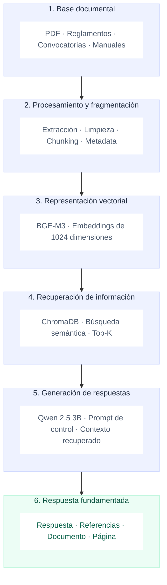

# Sistema RAG para Consulta Documental Institucional

Asistente conversacional basado en arquitectura **RAG (Retrieval-Augmented Generation)** diseñado para responder consultas de forma precisa, trazable y libre de alucinaciones a partir de documentación normativa y administrativa (reglamentos, convocatorias y manuales).

---

## Arquitectura del Pipeline

El flujo de datos consta de seis etapas secuenciales desde la ingesta documental hasta la generación de respuestas citadas:

## Descripción técnica por etapas
1. Ingesta de la base documental:
Se cargan las fuentes (archivos en formato PDF) correspondientes a reglamentos, convocatorias y manuales. El objetivo es centralizar el corpus de conocimiento oficial que servirá como única fuente de verdad para el modelo

2. Procesamiento y fragmentación
Extracción y limpieza de todo el texto plano, eliminando encabezados, caracteres corruptos y ruido tipográfico. En esta etapa se realiza un proceso de chunking (fragmentación / segmentación) de los documentos con un ligero solapamiento para preservar la continuidad semántica de los bloques.
Adicionalmente cada fragmento es etiquetado con su documento de origen y no. de página para garantizar la trazabilidad posterior. 
