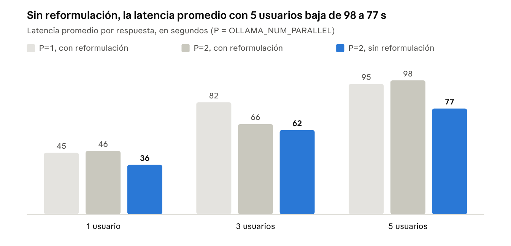

# Asistente Unison: resultados de pruebas de concurrencia y calidad

15 de noviembre de 2026 · Carlos López

El asistente respondió las 54 preguntas de las tres pruebas sin errores con hasta 5 usuarios simultáneos, pero cada respuesta tarda de 36 a 98 s en promedio porque la laptop no tiene GPU suficiente.

## Objetivo

Medir cómo se comporta el Asistente Unison (RAG v2) cuando varios usuarios preguntan al mismo tiempo, como pidió el profesor: qué máquina y qué configuración del modelo funcionan mejor de forma concurrente.

Se compararon tres configuraciones:

1. `OLLAMA_NUM_PARALLEL=1`, con reformulación de la pregunta.
2. `OLLAMA_NUM_PARALLEL=2`, con reformulación de la pregunta.
3. `OLLAMA_NUM_PARALLEL=2`, sin reformulación de la pregunta (`expand_queries=False`).

## Equipo y configuración

| Elemento | Valor |
| --- | --- |
| Laptop | Dell G3 3590, Windows 11 Home |
| Procesador | Intel Core i5-9300H |
| Memoria RAM | 32 GB |
| GPU | NVIDIA GTX 1050, 3 GB |
| Modelo de lenguaje | `qwen2.5:3b-instruct` vía Ollama, contexto de 8192 tokens |
| Modelo de embeddings | `bge-m3` (1024 dimensiones) |
| Base vectorial | ChromaDB, colección `unison_documents_v2`, 1,084 fragmentos de 15 documentos |
| Recuperación | `semantic_continuation`, con selección de pasajes |
| Servidor web | `app.py` con `ThreadingHTTPServer` (un hilo por usuario) |

Con `ollama ps`, el modelo ocupa 2.9 GB y corre **49% en CPU y 51% en GPU**: no cabe completo en los 3 GB de la tarjeta. Se confirmó en `server.log` que Ollama tomó `OLLAMA_NUM_PARALLEL=2`.

## Metodología

El script [`prueba_concurrencia.py`](../prueba_concurrencia.py) simula usuarios que preguntan al mismo tiempo y mide cada respuesta.

1. Hace una pregunta de calentamiento, que no se mide, para cargar los modelos en memoria.
2. Lanza 1, 3 y 5 usuarios simultáneos. Una "línea de salida" (`threading.Barrier`) hace que todos arranquen en el mismo instante.
3. Cada usuario toma una pregunta distinta de un banco de 10 (servicio social, becas, movilidad, cuotas, posgrado, etc.).
4. Cada nivel se repite 2 veces: 18 preguntas por configuración.
5. Se registran la latencia total (lo que espera el usuario), el tiempo de búsqueda y el de generación, y si la respuesta fue exitosa (HTTP 200).

Las preguntas por minuto se calculan como respuestas exitosas entre la suma de la duración de cada ronda.

Limitación: con 2 repeticiones por nivel la variación es alta. Para el informe final conviene subir a 3 o 5.

## Resultados

Las tres configuraciones respondieron 18 de 18 preguntas (HTTP 200), sin errores ni tiempos agotados.

| Configuración | Usuarios | Peor caso (s) | Preguntas/min | Búsqueda prom. (s) | Generación prom. (s) |
| --- | --- | --- | --- | --- | --- |
| P=1, con reformulación | 1 | 51.1 | 1.3 | 15.9 | 29.0 |
| P=1, con reformulación | 3 | 107.2 | 1.8 | 19.5 | 62.5 |
| P=1, con reformulación | 5 | 163.6 | 2.1 | 20.8 | 74.6 |
| P=2, con reformulación | 1 | 53.8 | 1.3 | 16.5 | 29.9 |
| P=2, con reformulación | 3 | 87.6 | 2.2 | 18.2 | 47.7 |
| P=2, con reformulación | 5 | 151.2 | 2.3 | 20.7 | 77.3 |
| P=2, sin reformulación | 1 | 44.2 | 1.7 | 5.9 | 30.3 |
| P=2, sin reformulación | 3 | 80.4 | 2.5 | 5.9 | 55.6 |
| P=2, sin reformulación | 5 | 122.9 | 2.8 | 6.2 | 71.1 |

Datos crudos: `resultados_parallel1.csv`, `resultados_parallel2.csv` y `resultados_parallel2_sin_expansion.csv` (en esta carpeta).

## Análisis

**Con varios usuarios se forma una fila.** En la ronda de 5 usuarios con P=2, las respuestas llegaron a los 85, 103, 117, 135 y 151 s, una cada ~16 s. Ollama atiende prácticamente una pregunta a la vez y el último usuario espera casi el triple que el primero.

**El cuello de botella es el hardware.** El modelo corre 49% en CPU porque no cabe en la GPU de 3 GB. Por eso pasar de P=1 a P=2 solo mejoró con 3 usuarios (82 → 66 s) y no con 5 (95 → 98 s): no hay memoria de GPU libre para atender dos peticiones en paralelo.

**La reformulación de la pregunta es costosa.** La búsqueda tomaba 16–21 s porque incluye una llamada extra al LLM para reescribir la pregunta. Sin ella bajó a ~6 s y dejó de crecer con la carga; la latencia promedio bajó 22% con 1 usuario y 21% con 5.

**El rendimiento total crece poco.** De 1.3 preguntas por minuto con 1 usuario a 2.8 con 5 (sin reformulación): mientras una pregunta busca, otra genera, pero la mejora está lejos de ser proporcional.

**Los dos modelos se turnan en la GPU.** Durante la prueba, `ollama ps` mostró solo `bge-m3` cargado (689 MB, 100% GPU), sin `qwen2.5`. Como no caben juntos en 3 GB, en cada pregunta Ollama descarga uno para cargar el otro, y esa recarga explica buena parte de los ~6 s de búsqueda.

## Evaluación de calidad

Sin reformulación, el asistente acertó 18 de 19 respuestas (94.7%) contra 17 de 19 con reformulación, y fue 24% más rápido (28.4 s contra 37.3 s por pregunta).

Se usaron 23 preguntas con respuesta verificada en los reglamentos ([`preguntas_evaluacion.json`](../preguntas_evaluacion.json)): 19 con respuesta en los documentos y 4 fuera de ellos, que deben responderse con abstención. El script [`evaluacion_calidad.py`](../evaluacion_calidad.py) las hizo una por una con cada configuración.

| Métrica | Con reformulación | Sin reformulación |
| --- | --- | --- |
| Recuperó el documento correcto | 100% | 100% |
| Recuperó la página correcta (±1) | 100% | 100% |
| Citó el documento correcto | 89.5% | 89.5% |
| Respuesta con los datos clave | 89.5% (17/19) | 94.7% (18/19) |
| Se abstuvo con respuesta disponible | 0% | 0% |
| Se abstuvo fuera de los documentos | 100% (4/4) | 100% (4/4) |
| Latencia promedio | 37.3 s | 28.4 s |

Errores encontrados:

| # | Pregunta | Configuración | Qué pasó |
| --- | --- | --- | --- |
| 10 | ¿Cuándo causa un alumno baja definitiva de la universidad? | Ambas | Respondió con las causas de baja automática de **posgrado** (Art. 87) en lugar del Reglamento Escolar (Art. 61: baja automática en dos programas). La página correcta sí se recuperó. |
| 12 | ¿Cuáles son las causas de baja automática en posgrado? | Con reformulación | Respondió con las reglas de **licenciatura** (Art. 60). Sin reformulación acertó. |
| 14 | ¿Cuánto cuesta un certificado parcial? | Ambas | El dato fue correcto (1.1 UMA), pero la cita apuntó a otro documento. |

**Hallazgo principal:** la recuperación es perfecta; los errores están en la generación. El modelo de 3B confunde licenciatura con posgrado cuando recibe fragmentos de ambos reglamentos, aunque el prompt le pide distinguirlos. Mejoras posibles: filtrar por nivel cuando la pregunta lo menciona, o un modelo más grande.

Nota: la pregunta 13 (costo del título) respondió en 0.1 s porque el pipeline tiene una ruta especial para cuotas que no usa el LLM.

Limitaciones: 19 preguntas es una muestra pequeña, y la revisión automática solo busca datos clave; las respuestas se revisaron a mano en `evaluacion_detalle.csv`. Para evitar sobreajuste, estas preguntas no deben usarse para ajustar el código; si se ajusta, hay que reservar un grupo nuevo como prueba final.

## Conclusiones y pendientes

1. **Estabilidad:** 54 de 54 preguntas respondidas en las tres pruebas, con hasta 5 usuarios simultáneos.
2. **Cuello de botella:** el hardware. Con una GPU de 3 GB el modelo corre a la mitad en CPU.
3. **Paralelismo de Ollama:** sin mejora clara de P=1 a P=2 en este equipo, por falta de memoria de GPU.
4. **Optimización de software:** quitar la reformulación reduce ~20% la latencia, sube la capacidad de 2.3 a 2.8 preguntas por minuto y no empeora la calidad (94.7% contra 89.5% de respuestas correctas). Se recomienda dejarla apagada.
5. **Recomendación:** para uso real, un servidor con GPU de 8 GB o más, donde el modelo quepa completo.

Pendientes:

- [x] Evaluar la calidad de las respuestas con y sin reformulación (`evaluacion_calidad.py`).
- [x] Confirmar con `ollama ps` si `bge-m3` y `qwen2.5` se alternan en memoria: confirmado.
- [ ] Probar `bge-m3` en CPU (`num_gpu: 0`) para que los modelos dejen de turnarse en la GPU.
- [ ] Repetir las pruebas de concurrencia con 3 a 5 repeticiones por nivel para el informe final.
- [ ] Atacar la confusión licenciatura/posgrado (filtro por nivel o modelo más grande).
